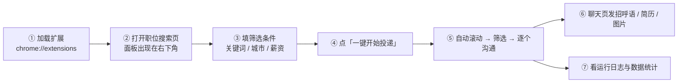
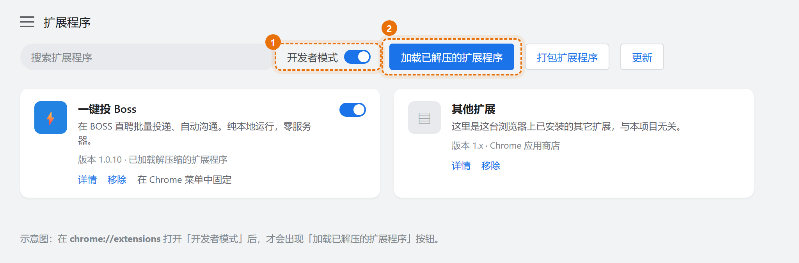
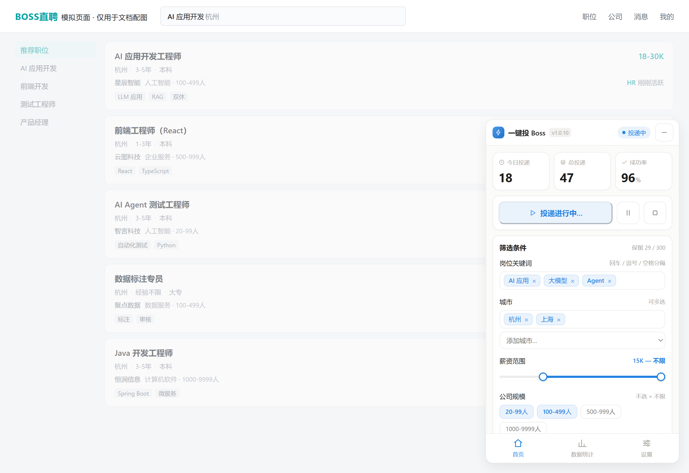
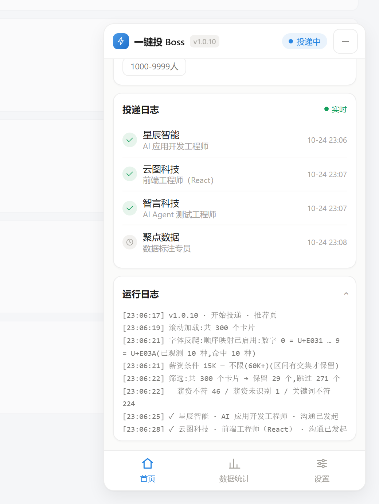
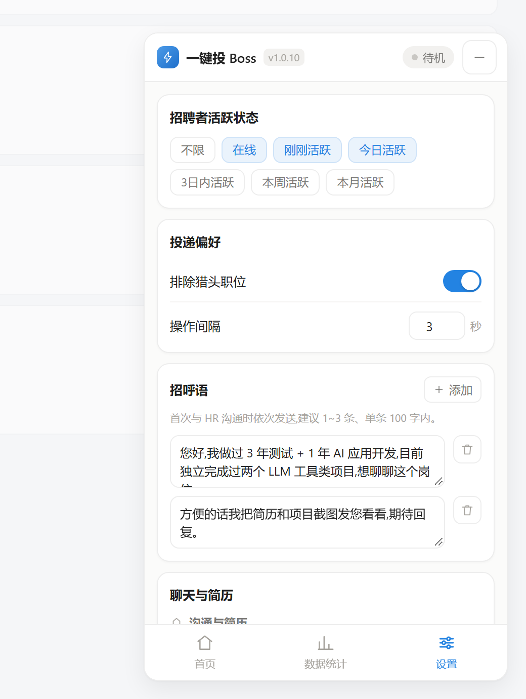
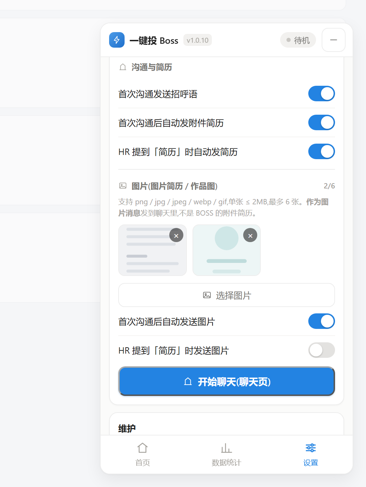
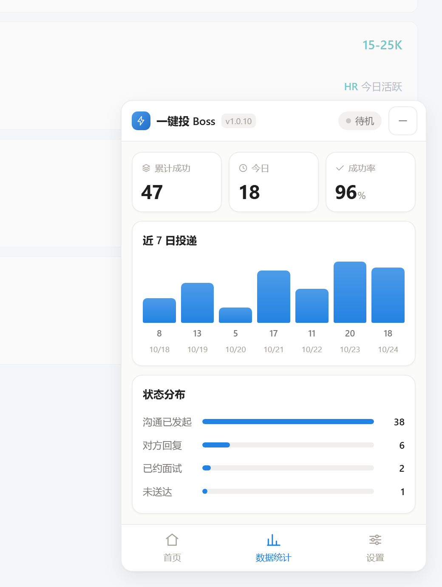

# 一键投 Boss

> 在 BOSS 直聘网页端批量投递、自动沟通的 Chrome / Edge 扩展（Manifest V3）。
> **纯本地运行**：零服务器、零账号、零上传。

`Chrome Extension MV3` · `JavaScript ES6+` · `原生 DOM` · `零运行时依赖` · `约 3000 行`

---

## 它解决什么问题

求职时在 BOSS 直聘上投岗位，是一个高度重复的动作：滚动、点卡片、点「立即沟通」、等弹窗、再滚。
一天点上百次，而且大部分岗位根本不符合条件。

这个扩展把这段流程压缩成一次点击：自动加载全部职位 → 按你的条件筛选 → 批量发起沟通 → 在聊天页自动发招呼语和简历。

---

## 功能

| 模块 | 能力 |
|---|---|
| **批量投递** | 自动滚到底加载全部职位，逐个点「立即沟通」，自动处理「留在此页」弹窗 |
| **多维筛选** | 职位关键词 / 城市 / 薪资区间 / 公司规模 / 招聘者活跃状态 / 排除猎头 |
| **自动沟通** | 多条招呼语依次发送；自动发送 BOSS 附件简历；HR 提到「简历」时自动触发 |
| **发送图片** | 通过 `DataTransfer` 注入文件，发送 png / jpg（图片简历、作品截图、二维码） |
| **任务控制** | 开始 / 暂停 / 继续 / 停止，完整的任务状态机，实时日志 |
| **数据统计** | 今日投递数、历史记录、成功率，全部可视化 |
| **页面诊断** | 一键输出选择器命中数、DOM 大纲、薪资节点码点、可一键复制日志 |

---

## 使用步骤

整体流程就六步：



### ① 安装扩展



1. 克隆或下载本仓库到本地
2. 打开 `chrome://extensions`（Edge 为 `edge://extensions`）
3. 右上角打开 **开发者模式**（图里 ①）
4. 点 **加载已解压的扩展程序**（图里 ②），选择本仓库的 `boss-haitu-free/` 目录
5. 列表里出现「一键投 Boss v1.0.x」即安装成功

> **更新扩展必须两步**：① 在扩展管理页点刷新（↻）② 回到 BOSS 页面按 `F5`。
> 已打开页面里的旧内容脚本会一直活着，只刷新扩展不刷新页面是不生效的。
> 面板标题上的版本号可用于确认当前跑的是哪一版。

### ② 打开职位搜索页

面板会自动出现在页面右下角（可拖拽，点 `—` 收起成小胶囊）。地址形如：

```
https://www.zhipin.com/web/geek/job?query=AI%20应用开发&city=101210100
```

> 推荐页 `/web/geek/jobs` 的卡片结构与搜索页不同，**建议在搜索页使用**。



### ③ 填筛选条件

在首页「筛选条件」卡片里从上往下填，填一项就少投一批无效岗：

| 字段 | 怎么填 | 说明 |
|---|---|---|
| **岗位关键词** | 回车 / 逗号 / 空格分隔 | 命中**任意一个**即可保留，如 `AI 应用` `大模型` `Agent` |
| **城市** | 下拉框逐个添加，标签可删 | 多选，命中任意一个即可 |
| **薪资范围** | 拖两个滑块 | 上滑块是下限、下滑块是上限；**区间有交集才保留** |
| **公司规模** | 点选胶囊 | 一个都不选 = 不限 |

右上角的「保留 29 / 300」是上次筛选的实时结果。

> **薪资滑块有个已知手感问题**：两个滑块是叠在一起的两层，鼠标拖到它们重合时可能抓到的是另一个。
> 遇到「上限拖不动 / 下限被一起拖走」，先点一下滑块外的空白，再拖另一个滑块，或直接把上限拖到最右端表示「不限」。

### ④ 一键开始投递

点蓝色主按钮，它会把当前列表滚到底加载全部职位，然后逐个「立即沟通」，并自动处理「留在此页」弹窗。

运行中的状态变化：

- 右上角状态胶囊：`待机` → `投递中`（蓝点呼吸）
- 主按钮：`一键开始投递` → `投递进行中…`（变浅、不可重复点）
- 旁边的 ⏸ 变成可点的**暂停 / 继续**，⏹ 变成可点的**停止**



两张卡片用途不同：

- **投递日志**：成功发起的沟通，一行一个公司 + 岗位，失败的那条是灰色时钟图标
- **运行日志**：完整过程（可折叠）。改版、读不到薪资、为什么跳过某个岗位，全写在这里

### ⑤ 聊天页：招呼语 / 简历 / 图片

投递完成后切到聊天页（地址含 `/web/geek/chat`），面板会换成沟通模式。先在**设置**页把这些配好：



- **招聘者活跃状态**：只跟「刚刚活跃 / 今日活跃」聊，回复率高很多
- **排除猎头职位**：勾上
- **操作间隔**：默认 2 秒，别调太快
- **招呼语**：可以写多条，首次沟通时**按顺序依次发送**；建议 1~3 条、单条 100 字内



- **自动发附件简历**：需要你**先在 BOSS 里上传过附件简历**，扩展只是替你去点那个按钮
- **图片**：png / jpg / webp / gif，单张 ≤ 2MB，最多 6 张。它是把图片**作为聊天图片消息**发出去，不是附件简历 —— 适合发图片版简历、作品截图、二维码
- 配好后点卡片底部的 **开始聊天（聊天页）**

### ⑥ 看数据

底部导航第二项，看近 7 日投递量和状态分布，用来判断是「岗位太少」还是「筛选太严」。



### 新手最容易卡的 5 个点

| 现象 | 先查这个 |
|---|---|
| 面板根本不出现 | 是不是在推荐页 `/web/geek/jobs`？换搜索页；再按一次 F5 |
| 改了代码没生效 | 扩展页刷新 ↻ + 页面 F5，两步都要做 |
| 薪资全是「未识别」 | 设置 → 维护 → 诊断页面，看「字体反爬」标定状态 |
| 附件简历发不出去 | 你的 BOSS 账号里有没有传过附件简历 |
| 数据一直是 0 | 展开运行日志，看被拒明细 —— 大概率是薪资或关键词卡太死 |

---

## 几个值得一说的工程细节

这类工具真正的难点不在「点按钮」，而在**怎么从不断改版的页面里可靠地读出数据**。下面是踩过坑之后沉淀下来的部分。

### 1. 薪资识别：三层递进 + 向上冒泡

BOSS 的职位卡片结构会把「职位名」和「薪资」拆到不同的兄弟节点里，而列表容器的选择器往往只命中其中一半。所以：

| 层 | 机制 | 作用 |
|---|---|---|
| ① | 已知选择器按优先级逐个试，并校验内容像不像薪资 | 常规情况最准 |
| ② | 单次遍历子树，先读属性明文、再读文本 | class 名整体改版也能兜住 |
| ③ | 整卡文本里正则抠一段 | 最后兜底 |

如果命中的元素只含标题那一半，会**向上冒泡**到同时含薪资的父节点 —— 但带一个安全阀：**父节点必须仍然只含一个职位名**，否则宁可停下，也不读到隔壁职位的薪资。

### 2. 字体反爬（PUA）的自动标定

BOSS 会把薪资里的数字 `0-9` 替换成 **Unicode 私用区（PUA, U+E000–U+F8FF）码位**，再用自定义字体渲染回数字的样子。

结果就是：页面看着是 `15-25K`，而 `textContent` 里数字**凭空消失**，只剩下 `- K`。任何基于 `textContent` 的解析在这一层必然失败 —— 这也是本项目最隐蔽的一个坑。

处理办法不是写死映射（字体是动态生成的，写死会某天**静默算错**），而是每次运行前**就地标定**：

```
① 采样    只从「薪资节点」取样，绝不扫全页
          （图标字体同样占用私用区，扫全页会把图标码位混进来）
② 枚举    任一已观测码位都可能对应 0-9 → 反推出 ≤ 10×N 个候选起始码位
③ 打分    逐个候选解码，看结果像不像「正经薪资」：
          有残留 / 前导 0（「04K」不合法）/ 数字越界（>500K）都扣分
④ 定标    取分最高者；同分时优先「不假设有更小数字缺失」的那个
```

**三项校验任何一项不过，就停用解密并在日志里写明原因。** 宁可让薪资显示「未识别」（用户会去手动确认），也绝不把错的薪资算进筛选条件 —— 把 8K 的岗位当成 20K 投出去，比读不到危险得多。

### 3. fail-closed，而不是 fail-open

解析不到薪资时，默认行为是**跳过该职位**，不是放行。

放行会让失败变得完全不可见：页面一改版，所有职位都「通过」筛选，用户以为筛选在生效，其实什么都没筛。改成跳过之后，失败会以「薪资未识别 N 个」的形式直接暴露在日志里，并且在解析数为 0 时给出明确告警。

### 4. 让日志自己回答「为什么被跳过」

筛选结果不只是一个数字，而是一份可自证的报告：

```
筛选:共 300 个卡片 → 保留 29 个,跳过 271 个
  字体反爬:顺序映射已启用:数字 0 = U+E031 … 9 = U+E03A(已观测 10 种,命中 10 种,校验通过 142 条)
  薪资条件 15K — 不限(60K+)(区间有交集才保留) / 薪资不符 46 / 薪资未识别 1 / 关键词不符 221
  ✕ 薪资不符:AI Agent 测试工程师 · 15-25K · 25K 低于下限 31K
```

边界是多少、每个职位为什么被跳过，都写在日志里。这样「筛选好像没生效」这类问题不需要靠猜。

---

## 代码结构

```
boss-haitu-free/
├── manifest.json        扩展清单（MV3、权限、注入规则）
├── background.js        Service Worker：图标徽标、今日计数、跨天复位
├── common/constants.js  共享常量 + 全部页面选择器（改版时只改这里）
├── content/app.js       内容脚本：面板 UI + 投递引擎 + 沟通引擎 + 薪资解析
├── content/app.css      面板样式
└── icons/               扩展图标
tools/
├── test-salary-parse.js   薪资解析回归测试（69 个用例）
└── test-salary-filter.js  筛选逻辑端到端测试（34 项断言）
docs/
├── images/                文档配图（PNG）
└── mock/                  配图源文件：直接引用真实的 content/app.css 复现面板，
                           用 Chrome 无头模式截图生成，界面改了就重截
```

设计上的一个取舍：**所有选择器集中在 `common/constants.js`**，页面改版时只改一处，不用在几千行里到处找。

---

## 测试

两个脚本都从 `content/app.js` **抽取真实代码块执行**，不是复制一份副本 —— 所以测的就是实际会跑的那段逻辑。

```bash
node tools/test-salary-parse.js    # 69/69
node tools/test-salary-filter.js   # 34/34
```

覆盖的场景包括：月/年/日/时薪与千/万/元换算、全角符号、13 薪后缀、开放上限、面议、
经验年限与公司规模不被误判为薪资、类名整体改版靠结构扫描兜底、向上冒泡不越界、
字体反爬（标准映射 / 起始码位变化 / 缺失数字校正 / 图标码位污染 / 非顺序映射时停用）。

---

## 诊断与排错

面板 → **设置 → 维护 → 诊断页面**，会输出：

- 每个候选选择器的命中数量
- 首卡片的 class 与文本
- 薪资识别自检（薪资原文 → 解析结果）
- 字体反爬标定状态与码点对照
- 首卡片的 DOM 大纲（逐层 tag / class / 文本）

**复制日志** 按钮可一键复制全部内容。

---

## 已知限制

- 页面结构由平台控制，改版后可能需要更新 `common/constants.js` 里的选择器。
- 若平台改用非连续 PUA 映射（码位乱跳或多套字体混用），解密会**主动停用并告知**，而不是猜。
- 推荐页（`/web/geek/jobs`）的卡片结构与搜索页不同，建议在搜索页（`/web/geek/job?query=...`）使用。
- 仅适配桌面端网页，不支持移动端页面。

---

## 免责声明

- 本项目仅供 **个人学习与技术研究** 使用。
- 自动化操作可能违反平台用户协议，存在账号受限风险。
- 请控制操作频率（建议间隔 ≥ 2 秒）与每日投递数量，尊重平台规则与招聘方。
- 使用本工具产生的一切后果由使用者自行承担。
